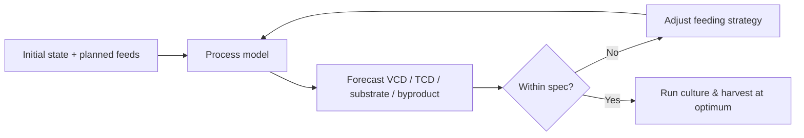
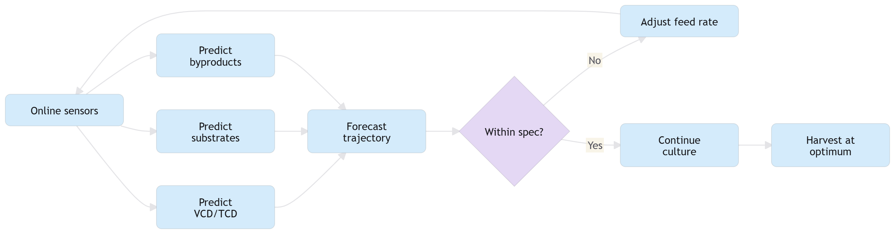
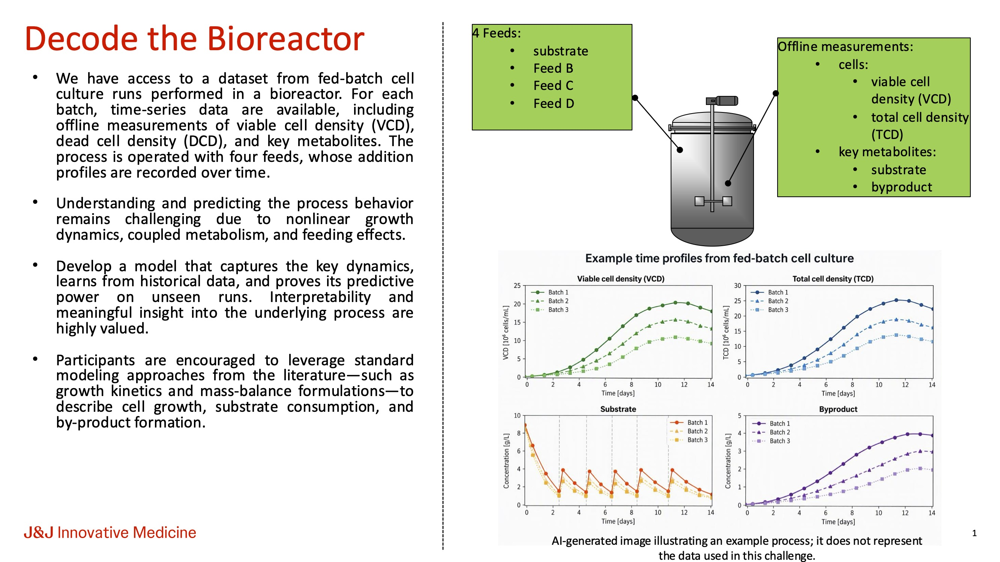

# Decode the Bioreactor

## Background: fed-batch cell culture
Each batch is one bioreactor run. CHO cells grow in a tank on a substrate (their food) and produce the protein of interest, typically a monoclonal antibody. While they grow, they also make (and later partly consume) a metabolic byproduct. Over the run, some cells die: viable cell density (VCD) peaks and declines while total cell density (TCD) keeps counting the dead cells.

The process is fed-batch. Four feeds (substrate, Feed B, Feed C, Feed D) are added during the run, which raises the volume and changes concentrations. The aim of process modelling is to predict how the culture will evolve under a given feeding strategy, so the feeding can be planned and the culture harvested at the right time.

In a real plant this loop would also use online sensors. **This dataset has only offline measurements.**

> Note: the example curves on the slide are AI-generated and do **not** represent the challenge data (for example, the byproduct in our data is not monotone).

## Data
All data is in `data/raw/bioreaction_remaining.csv`, in long format: one row per event, with columns NaN where they don't apply.

| Column | Meaning |
|---|---|
| `batch_id` | Run identifier (61 batches) |
| `elapsed_time` | Days since inoculation (0 to about 13) |
| `vcd`, `tcd` | Viable / total cell density, likely 10⁶ cells/mL (range about 1–40) |
| `substrate`, `byproduct` | Concentrations. Units not stated (the slide example uses g/L) |
| `feed_substrate`, `feed_b`, `feed_c`, `feed_d` | Feed addition events (amounts). Only set on feed rows |
| `volume` | Reactor volume. Rises as feeds are added |
| `to_predict` | `True` on the test timestamps we must forecast |

Each row is exactly one of:
- a **sample row**: `volume` is set, and the measurement columns are set unless the row is to be predicted; or
- a **feed event**: exactly one `feed_*` column is set, everything else is NaN.

The file contains **all 61 batches**, both training and test:

| | Training batches (49) | Test batches (12): 5, 6, 12, 24, 32, 35, 40, 48, 54, 56, 57, 60 |
|---|---|---|
| Measurements | All 14 sampling days (day 0–13) | **Only t = 0**. All later measurements are NaN |
| Feed events | Yes | Yes, the full schedule |
| Volume | Yes | Yes, including at the timestamps to predict |
| `to_predict` | Always False | True on the 13 sampling times after t = 0 |

`data/raw/bioreaction_template.csv` is the submission template. It holds exactly the 156 `to_predict == True` rows (12 batches × 13 timestamps), with the targets set to 0.

So *"only the first timestamp is given"* means only the first **measurement** is given. The timestamps to predict, the feeds and the volume are known for the whole run. **The test targets are not in the file, so there is no train/test leakage in the data itself.**

> **Joining gotcha:** the template stores times rounded to 9 decimals, while the CSV has full float precision. An exact merge on `elapsed_time` matches only 2 of the 156 rows. Align on `batch_id` plus sorted order, or with a tolerance (the true difference is < 1 ms).

Sampling: every batch has exactly 14 sampling times, one per day. Gaps are 23.8 ± 0.8 h (range 20–26 h), and all times fall within about 3 h of the whole day (usually slightly before it). The test timestamps follow the same pattern.

Observed properties:
- `vcd ≤ tcd` always. Dead cell density DCD = TCD − VCD ≥ 0.
- The byproduct falls between consecutive samples about 8 of 13 times per batch, so it is consumed as well as produced (similar to a lactate shift).
- All targets are strictly positive.

### Feeds
A *feed* is anything added to the reactor during the run. In fed-batch culture, nutrients are supplied gradually as concentrated solutions rather than all at the start. Using several separate feeds is standard: some components can't be mixed (stability, solubility, pH) or are needed at different rates.

**The feed schedules and volume are known for the test batches too.** Only the four measurements after t = 0 are hidden. The feeds are the main thing that differs between batches, so they are the key model inputs.

The feeds are anonymised. The roles below are inferred from the data, not given by the challenge:

| Feed | Events / batch | Starts around | Spacing | Typical amount | Likely role |
|---|---|---|---|---|---|
| Feed B | ~12 | day 1 | ~24 h | ~0.5, rising | Main nutrient feed (concentrated medium, likely contains substrate). Its per-batch total ≈ the volume increase (r = 0.99) |
| Substrate | ~2 | day 11.5 | – | ~0.07 | Late top-up of the main substrate |
| Feed C | ~14 | day 3 | ~16 h | ~0.001 | Trace additive or control agent (e.g. base, antifoam). Negligible volume |
| Feed D | ~3 | day 5 | ~60 h | ~0.015 | Supplement (e.g. separately fed amino acids) |

Per-batch feed totals are almost identical on average between train and test, so the test batches follow the same kind of recipe.

Modelling implications:
- Feed B drives the volume increase, and with it the dilution of every concentration.
- Feed B and the substrate feed should enter the substrate mass balance directly.
- Feeds C and D more likely act on growth, death or byproduct metabolism. Test them as covariates rather than hard-coding a role.

### The feeding is adaptive (feeds carry information about the outcome)
Feed B amounts correlate at r = 0.87 with the most recent VCD measurement before each feed. Feed B ≈ 0.027 × the last measured VCD, give or take about 23%. Part of this is a shared trend over time; within the same day the correlation is weaker, r = 0.31. Even so, it looks like **cell-specific feeding**: operators dose according to the measured cell count.

Consequences:
- **For the leaderboard, this is useful and legitimate.** The test feed schedules are given, and they partly reveal how well each test batch was growing. In particular, the first feed *after* a sample reflects the measurement at that sample.
- **For interpretation, be careful.** Part of the feed–growth link runs "more cells → more feed", not "more feed → more cells". A model that learns this predicts poorly for a new feeding strategy that hasn't been run. Don't present such associations as causal process insight.
- **Mechanistic and hybrid models** use feeds as mass inputs (the causal direction). Data-driven models such as GBT will also exploit the reverse signal. This is one reason the two complement each other in an ensemble.

## The task
For each test batch, predict VCD, TCD, substrate and byproduct at every timestamp in the template, given:
- the measured state at t = 0, and
- the known feed events and volume over the whole run.

This is an **initial-value problem with known inputs**: simulate x(t) from x(0) and the feeds u(t). It is not autonomous forecasting. Keep the template's format unchanged (same batches, timestamps and column names).

Physical constraints a good model should respect:
- All quantities are ≥ 0.
- VCD ≤ TCD.
- Concentrations are diluted by volume increases and raised by feeds.

## Scoring
Predictions are compared with the hidden ground truth using MAPE, computed separately for each of the 4 variables. The final score is the unweighted mean of the 4 MAPEs (lower is better). The leaderboard shows each variable's MAPE and the final score.

With the standard definition, |y − ŷ| / y:
- Underprediction is capped at 100% when ŷ ≥ 0. The all-zero template scores exactly 100.
- Overprediction is unbounded.
- Small true values (early VCD/TCD, low byproduct) carry the most weight.
- The MAPE-optimal point forecast lies below the median, so fitting on log scale or relative error suits the metric better than MSE.

> **Open question:** the challenge text was paraphrased as "overprediction capped at 100%, underprediction unlimited". That only holds if the error is divided by the prediction rather than the truth. Confirm the exact formula with the organisers before tuning any bias.

## Validation strategy
We use the team's **frozen split**, `references/splits.csv` (one row per batch: `role`, `fold`):

| Role | Batches | Used for |
|---|---|---|
| `dev` | 39 | Model selection with 5-fold CV (frozen `fold` 0–4: train on 4 folds, validate on 1) |
| `holdout` | 10 | **Final reality check only**, plus y vs. ŷ plots. Never used to choose between models |
| `test` | 12 | Graded by the organisers. No labels, unseen by us |

Models for the holdout check are fitted on `dev` only. The submission model is **refitted on dev + holdout** (all 49 labelled batches).

- **The 12 test batches are excluded from all supervised training and validation.** They have no targets after t = 0. Their x(0), feeds and volume are used only as inputs at prediction time.
- **Batch-wise folds.** Every row of a batch lands in the same fold. A row-wise split leaks badly: neighbouring days of the same run are nearly identical.
- **Time dependencies:** each validation batch is predicted exactly as a test batch would be. Inputs are its t = 0 measurements, its sampling times, its feed schedule and its volume. Nothing measured after t = 0 is ever used as an input. Because the test set also gives the **whole** feed and volume history, using feeds after time t is *not* leakage here. What would leak is using *measurements* after t = 0 (e.g. teacher forcing or interpolation) at validation time. Since the batches are independent runs and the test batches are spread across the ID range, no forward-chaining split across batches is needed.
- **Preprocessing:**
  - Row-wise transforms are stateless and cannot leak: log, fold change vs. t = 0, per-volume concentrations, cumulative feeds within a batch. They can live outside the CV loop.
  - Anything *fitted* on data must sit inside the estimator or `Pipeline` and be refit per fold: scalers, PCA, target encoders, per-timepoint medians.
- **Metric:** score each fold with the challenge metric (mean of the 4 per-variable MAPEs), not with the training loss.

## Modelling plan
1. **Data handling:** split the long format into a sample table and a feed-event table. Never forward-fill across them.
2. **Validation:** as described above.
3. **Baseline:** per-timepoint median (or log-mean) trajectory across training batches, scaled by the initial values.
4. **Mechanistic / hybrid model:** mass-balance ODEs with dilution by volume. Monod-type growth, a death rate, substrate uptake, and byproduct production and consumption. Fit shared (and possibly batch-varying) parameters. Optionally add a learned correction term.
5. **Parameterise for the constraints:** e.g. model log VCD and a viability fraction in (0, 1] so that non-negativity and VCD ≤ TCD hold by construction.
6. **Interpretability:** report the fitted kinetic parameters and how they relate to the feeding strategy. The challenge values this.
