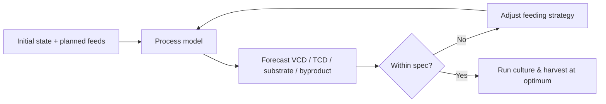

# Decode the Bioreactor

## Background: fed-batch cell culture
Each batch is one bioreactor run. CHO cells grow in a tank on a substrate (their food) and produce the protein of interest, typically a monoclonal antibody. While they grow, they also make (and later partly consume) a metabolic byproduct. Over the run, some cells die: viable cell density (VCD) peaks and declines while total cell density (TCD) keeps counting the dead cells.

The process is fed-batch. Four feeds (substrate, Feed B, Feed C, Feed D) are added during the run, which raises the volume and changes concentrations. The aim of process modelling is to predict how the culture will evolve under a given feeding strategy, so the feeding can be planned and the culture harvested at the right time.

In a real plant this loop would also use online sensors. **This dataset has only offline measurements.**

> Note: the example curves on the slide are AI-generated and do **not** represent the challenge data (for example, the byproduct in our data is not monotone).

## Data
All data is in `data/raw/bioreaction_remaining.csv`, in long format: one row per event, with columns NaN where they don't apply.

| Column | Meaning |
|---|---|
| `batch_id` | Run identifier (61 batches) |
| `elapsed_time` | Days since inoculation (0 to about 13) |
| `vcd`, `tcd` | Viable / total cell density, likely 10⁶ cells/mL (range about 1–40) |
| `substrate`, `byproduct` | Concentrations. Units not stated (the slide example uses g/L) |
| `feed_substrate`, `feed_b`, `feed_c`, `feed_d` | Feed addition events (amounts). Only set on feed rows |
| `volume` | Reactor volume. Rises as feeds are added |
| `to_predict` | `True` on the test timestamps we must forecast |

Structure:
- **Measurement rows:** about daily, roughly 14 per batch, at irregular times. Feed rows are interleaved between them.
- **Training batches (49):** full measurement trajectories, feeds and volume.
- **Test batches (12):** measurements **only at t = 0**, but the **full feed schedule and volume trajectory** are given. Rows to predict have `to_predict == True`.
- `data/raw/bioreaction_template.csv` is the submission template (12 batches × 13 timestamps, matching the `to_predict` rows).

Observed properties:
- `vcd ≤ tcd` always. Dead cell density DCD = TCD − VCD ≥ 0.
- The byproduct falls between consecutive samples about 8 of 13 times per batch, so it is consumed as well as produced (similar to a lactate shift).
- All targets are strictly positive.

## The task
For each test batch, predict VCD, TCD, substrate and byproduct at every timestamp in the template, given:
- the measured state at t = 0, and
- the known feed events and volume over the whole run.

This is an **initial-value problem with known inputs**: simulate x(t) from x(0) and the feeds u(t). It is not autonomous forecasting. Keep the template's format unchanged (same batches, timestamps and column names).

Physical constraints a good model should respect:
- All quantities are ≥ 0.
- VCD ≤ TCD.
- Concentrations are diluted by volume increases and raised by feeds.

## Scoring
Predictions are compared with the hidden ground truth using MAPE, computed separately for each of the 4 variables. The final score is the unweighted mean of the 4 MAPEs (lower is better). The leaderboard shows each variable's MAPE and the final score.

With the standard definition, |y − ŷ| / y:
- Underprediction is capped at 100% when ŷ ≥ 0. The all-zero template scores exactly 100.
- Overprediction is unbounded.
- Small true values (early VCD/TCD, low byproduct) carry the most weight.
- The MAPE-optimal point forecast lies below the median, so fitting on log scale or relative error suits the metric better than MSE.

> **Open question:** the challenge text was paraphrased as "overprediction capped at 100%, underprediction unlimited". That only holds if the error is divided by the prediction rather than the truth. Confirm the exact formula with the organisers before tuning any bias.

## Modelling plan
1. **Data handling:** split the long format into a measurement table and a feed-event table. Never forward-fill across them.
2. **Validation:** grouped CV by batch that mimics the test setup: keep t = 0 plus feeds and volume, simulate forward, and score with the challenge metric.
3. **Baseline:** per-timepoint median (or log-mean) trajectory across training batches, scaled by the initial values.
4. **Mechanistic / hybrid model:** mass-balance ODEs with dilution by volume. Monod-type growth, a death rate, substrate uptake, and byproduct production and consumption. Fit shared (and possibly batch-varying) parameters. Optionally add a learned correction term.
5. **Parameterise for the constraints:** e.g. model log VCD and a viability fraction in (0, 1] so that non-negativity and VCD ≤ TCD hold by construction.
6. **Interpretability:** report the fitted kinetic parameters and how they relate to the feeding strategy. The challenge values this.
