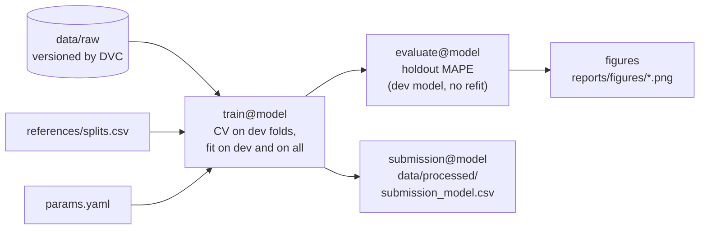

# Reproducible pipeline (DVC)

Every number in our reports and slides comes out of one DVC pipeline, defined in
[`dvc.yaml`](../dvc.yaml) and configured in [`params.yaml`](../params.yaml). The aim is that
anyone can rebuild any result with one command, see exactly what produced it, and try a change
without editing code.

## Commands

| Command | What it does |
|---|---|
| `make pipeline` (`dvc repro`) | Rebuild everything that is out of date, and nothing else |
| `dvc repro train@xgb_raw` | One stage of one model |
| `make metrics` (`dvc metrics show`) | CV and holdout MAPE of every model |
| `dvc metrics diff main` | How the metrics changed relative to `main` |
| `dvc exp run --set-param xgb.max_depth=4` | Try a parameter change as a tracked experiment |
| `dvc exp show` | Compare experiments side by side |
| `make test` | Leakage and holdout-isolation tests, among others |

DVC decides what is out of date from the hashes recorded in `dvc.lock`: the data, the code each
stage depends on, the parameters it reads, and its outputs. Changing `hybrid_v3.blend_weight`
reruns the training stages; editing `plots.py` reruns only the figures.

## What is stored where

| What | Where | In git? |
|---|---|---|
| Code, `params.yaml`, `dvc.yaml`, `dvc.lock`, `uv.lock` | repository | yes |
| Raw challenge data | `data/raw/` | no; only its hash, in `data/raw.dvc` |
| Fitted models | `models/<model>_{dev,all}.pkl` | no; rebuilt by `make pipeline` |
| Stage-1 fit cache of hybrid v3 | `models/cache/` | no |
| CV scores per fold | `reports/cv/<model>.csv` | yes |
| Metrics (CV and holdout MAPE) | `reports/metrics/cv_<model>.json`, `<model>.json` | yes |
| Holdout predictions (no measured values) | `reports/holdout/<model>.csv` | yes |
| Figures | `reports/figures/*.png` | yes |
| Submissions | `data/processed/submission_<model>.csv` | no (derived from the data) |

Results are in git, so they can be reviewed without rerunning anything. Data and model files are
not, and no file in `reports/` contains measured values: the challenge data never leaves this
machine through git. There is no DVC remote; set one up only
if the hackathon's data rules allow it.

## Rules the pipeline enforces

- **The holdout is a reality check, not a selection tool.** Choose between models and settings
  using the CV metrics (`cv_mape`). `evaluate` only scores the holdout with the model fitted on
  dev batches, and refuses a model whose recorded `fitted_batches` include holdout batches.
- **No leakage across batches or time.** Features use only a batch's own inputs: its t = 0
  measurement, sampling times, volumes and feeds. Anything learned, including pooled
  statistics, is learned inside `fit` on the training batches. `tests/test_data.py` checks
  this for every model (`make test`).
- **Submissions are fitted on all 49 labelled batches** (`<model>_all.pkl`). The holdout check
  uses the model fitted on the 39 dev batches (`<model>_dev.pkl`).

## Models

| Name | What it is | Code |
|---|---|---|
| `null_constant` | Mean of each variable over all times and batches | `modeling/models.py` |
| `null_per_day` | Mean of each variable per culture day (the "recipe" curve) | `modeling/models.py` |
| `xgb_raw` | XGBoost on raw features and raw targets | `modeling/train.py` |
| `xgb_log_fold_change` | XGBoost on log(y_t / y_0) | `modeling/models.py` |
| `null_xgb_ensemble` | 50/50 average of `null_per_day` and `xgb_raw` | `modeling/models.py` |
| `hybrid_v3` | Hybrid ODE + soft sensors + 50/50 blend with boosting (team model) | `modeling/hybrid_v3.py` |

### Hybrid v3

`hybrid_v3` is ported from branch `hybrid_v3_tr` (`src/sartorius_model.py`,
`src/hybrid_model.py`, `src/hybrid_v3.py`) into three modules:
`modeling/mechanistic.py` (the ODE), `modeling/hybrid.py` (the ODE with neural-net
rate corrections, stage 1) and `modeling/hybrid_v3.py` (soft sensors, both branches, blend).
The port reproduces the original's simulators exactly and its stage 2 to within 0.03 MAPE.
It also fixes two leaks of the original:

1. **Stacking.** Stage 2 was trained on stage-1 predictions from models that had seen the
   batches stage 2 was later tested on. Now the stage-1 predictions for stage 2's training rows
   come from inner folds over the training batches only.
2. **Pooled statistics.** The per-day mean feed schedule and the per-sample volume loss were
   computed over all 61 batches. Now they are learned from the training batches in `fit`.

Stage 1 is expensive: about 15 minutes per fit on 16 cores, and six fits per v3 fit (all
training batches plus five inner folds). Fits are cached in `models/cache/`, keyed on the
training data and the stage-1 settings, so rerunning on the same batches (figures, reruns,
stage-2 experiments) is quick.

## Adding a model

1. Write an estimator with the scikit-learn API (`fit(X, Y)`, `predict(X)` returning a DataFrame
   of the 4 targets). X carries `batch_id` next to the features.
2. Register a factory in `MODELS` in `modeling/train.py`; put its hyperparameters in
   `params.yaml`.
3. Add its name to `models:` in `params.yaml`, to `FIGURES` in `plots.py`, and to the
   leakage tests in `tests/test_data.py`.
4. Run `make pipeline`, then `dvc metrics diff`.
