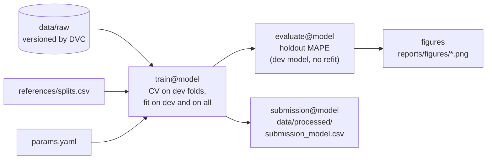

# Reproducible pipeline (DVC)

Every number in our reports and slides comes out of one DVC pipeline, defined in
[`dvc.yaml`](../dvc.yaml) and configured in [`params.yaml`](../params.yaml). The aim is that
anyone can rebuild any result with one command, see exactly what produced it, and try a change
without editing code.



## Commands

| Command | What it does |
|---|---|
| `make pipeline` (`dvc repro`) | Rebuild everything that is out of date, and nothing else |
| `dvc repro train@xgb_raw` | One stage of one model |
| `make metrics` (`dvc metrics show`) | CV and holdout MAPE of every model |
| `dvc metrics diff main` | How the metrics changed relative to `main` |
| `dvc exp run --set-param xgb.max_depth=4` | Try a parameter change as a tracked experiment |
| `dvc exp show` | Compare experiments side by side |
| `make test` | Leakage and holdout-isolation tests, among others |
| `python -m bioreactor_decoding.modeling.compare <model>` | Per-fold CV comparison and verdict |
| `gto show` (from the git root) | Registered model versions |

DVC decides what is out of date from the hashes recorded in `dvc.lock`: the data, the code each
stage depends on, the parameters it reads, and its outputs. Changing `hybrid_v3.blend_weight`
reruns the training stages; editing `plots.py` reruns only the figures.

## Versioning models

Model versions are git tags, managed with [GTO](https://dvc.org/doc/gto), DVC's model
registry. They replace "_v2", "_v3" suffixes in file names. The models are declared under
`artifacts:` in `dvc.yaml`; a version tag points at the commit whose code, `params.yaml`
and `dvc.lock` produced that model, so `git checkout <tag> && make pipeline` rebuilds it.

```bash
gto show                                                   # every model and its latest version
gto history bioreactor_decoding/dvc.yaml:hybrid_v3         # all versions of one model
gto describe bioreactor_decoding/dvc.yaml:hybrid_v3@v1.0.0 # commit, path, description
gto register bioreactor_decoding/dvc.yaml:hybrid_v3 --bump-minor   # after an improvement
```

Run GTO from the repository root (the git root is one level above this project).
Semantic versioning for a model:

| Bump | When | Example |
|---|---|---|
| major | A different modelling approach, or a change of the evaluation protocol | v1 → v2 |
| minor | A new component or a retuned parameter that changes predictions | v1.0 → v1.1 |
| patch | Same predictions, cleaner code, or a fix that does not change the scores | v1.0.0 → v1.0.1 |

A model name stays the same across versions (`hybrid_v3` is the name of the team model, not a
version number). An idea is tried first as a `dvc exp run` experiment and gets a version only
if it passes the per-fold rule below.

## Experiments and the decision rule

All runs use the same 5 dev folds, so the per-fold *difference* between two runs is much
less noisy than the spread of scores across folds. A change is adopted only if its CV MAPE
is lower on average **and** in at least 4 of the 5 folds:

```bash
dvc exp run -n my_idea --set-param hybrid_lite.blend_weight=0.6
python -m bioreactor_decoding.modeling.compare hybrid_lite                  # vs. git HEAD
python -m bioreactor_decoding.modeling.compare hybrid_blend --baseline hybrid_v3
```

Screen ideas on `hybrid_lite` (about 12 minutes for a full CV), then confirm on the other
hybrids. Results, including the rejected ideas, go in [the experiment log](experiments.md).

## What is stored where

| What | Where | In git? |
|---|---|---|
| Code, `params.yaml`, `dvc.yaml`, `dvc.lock`, `uv.lock` | repository | yes |
| Raw challenge data | `data/raw/` | no; only its hash, in `data/raw.dvc` |
| Fitted models | `models/<model>_{dev,all}.pkl` | no; rebuilt by `make pipeline` |
| Stage-1 fit cache of hybrid v3 | `models/cache/` | no |
| CV scores per fold | `reports/cv/<model>.csv` | yes |
| Metrics (CV and holdout MAPE) | `reports/metrics/cv_<model>.json`, `<model>.json` | yes |
| Holdout predictions (no measured values) | `reports/holdout/<model>.csv` | yes |
| Figures | `reports/figures/*.png` | yes |
| Submissions | `data/processed/submission_<model>.csv` | no (derived from the data) |

Results are in git, so they can be reviewed without rerunning anything. Data and model files are
not, and no file in `reports/` contains measured values: the challenge data never leaves this
machine through git. There is no DVC remote; set one up only
if the hackathon's data rules allow it.

## Rules the pipeline enforces

- **The holdout is a reality check, not a selection tool.** Choose between models and settings
  using the CV metrics (`cv_mape`). `evaluate` only scores the holdout with the model fitted on
  dev batches, and refuses a model whose recorded `fitted_batches` include holdout batches.
- **No leakage across batches or time.** Features use only a batch's own inputs: its t = 0
  measurement, sampling times, volumes and feeds. Anything learned, including pooled
  statistics, is learned inside `fit` on the training batches. `tests/test_data.py` checks
  this for every model (`make test`).
- **Submissions are fitted on all 49 labelled batches** (`<model>_all.pkl`). The holdout check
  uses the model fitted on the 39 dev batches (`<model>_dev.pkl`).

## Models

| Name | What it is | Code |
|---|---|---|
| `null_constant` | Mean of each variable over all times and batches | `modeling/models.py` |
| `null_per_day` | Mean of each variable per culture day (the "recipe" curve) | `modeling/models.py` |
| `xgb_raw` | XGBoost on raw features and raw targets | `modeling/train.py` |
| `xgb_log_fold_change` | XGBoost on log(y_t / y_0) | `modeling/models.py` |
| `null_xgb_ensemble` | 50/50 average of `null_per_day` and `xgb_raw` | `modeling/models.py` |
| `hybrid_v3` | Hybrid ODE + soft sensors + 50/50 blend with boosting (team model) | `modeling/hybrid_v3.py` |
| `hybrid_lite` | `hybrid_v3`'s stage 2 on a mechanistic stage 1 without neural nets | `modeling/lite.py` |
| `hybrid_blend` | Average of `hybrid_v3` and `hybrid_lite` (current best, CV 7.95) | `modeling/train.py` |
| `mechanistic_lite` | Pure mechanistic: `hybrid_lite`'s ODE alone, no data-driven correction (CV 13.56) | `modeling/models.py` (`Stage1Only`) |
| `ml_sensors` | Ridge + XGBoost with volume and bolus soft sensors, no ODE (branch `3_ML_models`) | `modeling/ml_sensors.py` |
| `hybrid_v7` | Tobias' 4-model blend on sensor-assimilated cores (leaderboard 6.752; run from a pinned commit) | `modeling/external_v7.py` |
| `hybrid_blend_ml` | Geometric average of `hybrid_blend` and `ml_sensors` (CV 7.79, better in 3/5 folds) | `modeling/train.py` |

### Hybrid v3

`hybrid_v3` is ported from branch `hybrid_v3_tr` (`src/sartorius_model.py`,
`src/hybrid_model.py`, `src/hybrid_v3.py`) into three modules:
`modeling/mechanistic.py` (the ODE), `modeling/hybrid.py` (the ODE with neural-net
rate corrections, stage 1) and `modeling/hybrid_v3.py` (soft sensors, both branches, blend).
The port reproduces the original's simulators exactly and its stage 2 to within 0.03 MAPE.
It also fixes two leaks of the original:

1. **Stacking.** Stage 2 was trained on stage-1 predictions from models that had seen the
   batches stage 2 was later tested on. Now the stage-1 predictions for stage 2's training rows
   come from inner folds over the training batches only.
2. **Pooled statistics.** The per-day mean feed schedule and the per-sample volume loss were
   computed over all 61 batches. Now they are learned from the training batches in `fit`.

Stage 1 is expensive: about 15 minutes per fit on 16 cores, and six fits per v3 fit (all
training batches plus five inner folds). Fits are cached in `models/cache/`, keyed on the
training data and the stage-1 settings, so rerunning on the same batches (figures, reruns,
stage-2 experiments) is quick.

### Hybrid lite and the similarity member

Both come from branch `06_hybrid_tr_based`:

- **`hybrid_lite`** is `HybridV3` with a different stage 1: a mechanistic ODE with a latent
  nutrient and no neural nets, fitted block by block (cells, substrate, byproduct) and then
  jointly (`modeling/lite.py`). The port reproduces the original's simulator and starting values
  exactly. One stage-1 fit takes about 75 s instead of about 15 minutes: stage 2 does most of the
  work, so a cruder stage 1 costs little accuracy.
- **The similarity member** (`similarity_weight` in `params.yaml`; 1/3 in both hybrids) is a
  third blend member for VCD and TCD. It predicts a batch's correction curve from its k most
  similar training batches at t = 0, with distances on descriptors standardised inside `fit`.

### Hybrid v7 (external, pinned commit)

Tobias' best model (branch `hybrid_v3_tr`, commit `1881069`): a geometric blend of four
models, with weights per variable and per day segment (days 1-6, 7-13):

1. hybrid v3's stage 2 on a **sensor-conditioned Monod core**: 400 per-batch parameter draws
   (growth, yield, death, lactate consumption, t = 0 cell count) weighted by how well they
   match the glucose interval implied by the bolus controller and the unlogged volume;
2. a functional-PCA trajectory model on the same kind of core;
3. hybrid v3 itself;
4. hybrid v3's stage 2 on a **two-population core** (growing cells switch to a
   non-growing, lactate-consuming state).

Glucose is then set to the MAPE-optimal point inside the bolus-rule interval, and TCD to VCD
times a modelled TCD/VCD ratio. Version history in his protocol (7-fold CV over the 49
labelled batches): v3 7.674 → v5 stack 7.366 (leaderboard 7.137) → v6 7.244 → **v7 7.187
(leaderboard 6.752)**.

It is not rewritten: `dvc repro hybrid_v7` checks out the commit in `params.yaml`
(`hybrid_v7.ref`) as a git worktree in `external/`, runs `src/hybrid_v7.py` unchanged (about
a minute; the cores' outputs are committed on his branch) and collects the submission and
`reports/metrics/hybrid_v7.json`. Two caveats, both recorded in that file:

- **Different protocol.** `cv7_mape` is his 7-fold CV, not our 5 dev folds (`cv_mape`), and
  the stage-2 models inherit the original v3's stacking (stage-1 out-of-fold predictions from
  the same folds), so it is slightly optimistic. The leaderboard score is the honest number.
- **The rerun differs slightly from the submitted file** (median 0.22%, one value 19.8%:
  Batch48, day 2). The rerun is deterministic and independent of the Python environment, so
  the submitted file was written from cached core outputs that changed before the commit.
  The registered artifact is the submitted file.

## Resource footprint

`train` writes `reports/metrics/footprint_<model>.json`: wall-clock time of the CV and of each
final fit, peak memory, model size and the number of cores; `evaluate` adds the prediction time
per batch. For the hybrid models it also records whether stage 1 came from the cache. A cached
fit costs seconds, so read the time of a fit only together with that flag. Uncached, a
`hybrid_v3` fit takes about 15 minutes on 16 cores.

## Adding a model

1. Write an estimator with the scikit-learn API (`fit(X, Y)`, `predict(X)` returning a DataFrame
   of the 4 targets). X carries `batch_id` next to the features.
2. Register a factory in `MODELS` in `modeling/train.py`; put its hyperparameters in
   `params.yaml`.
3. Add its name to `models:` in `params.yaml`, to `FIGURES` in `plots.py`, and to the
   leakage tests in `tests/test_data.py`.
4. Run `make pipeline`, then `dvc metrics diff`.
