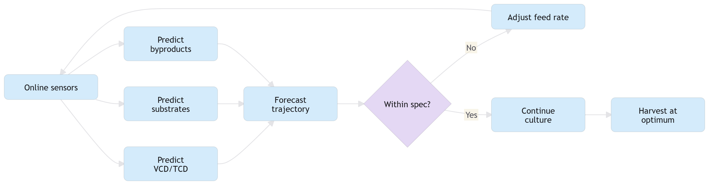
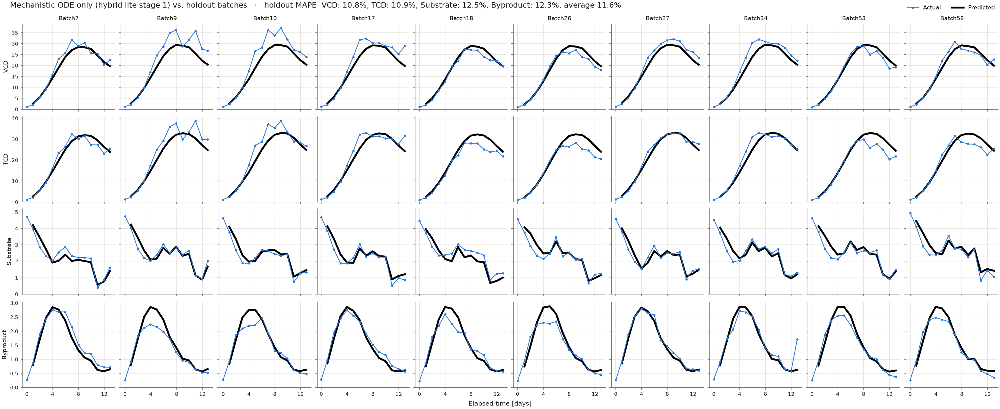
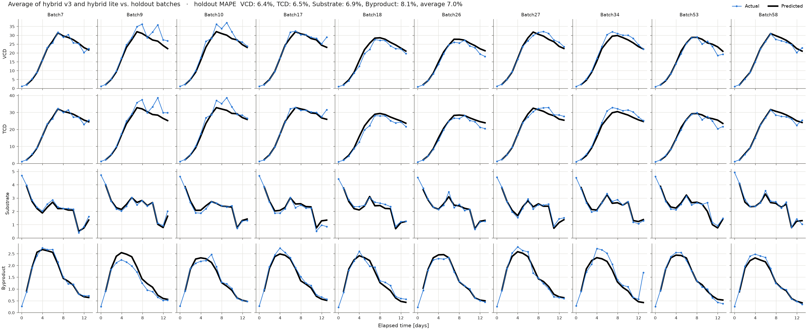
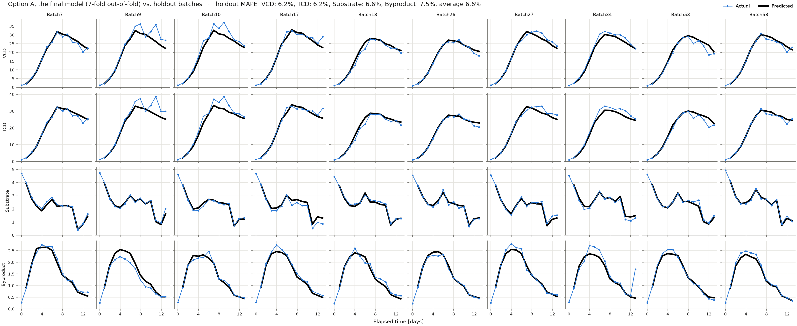
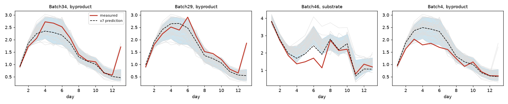
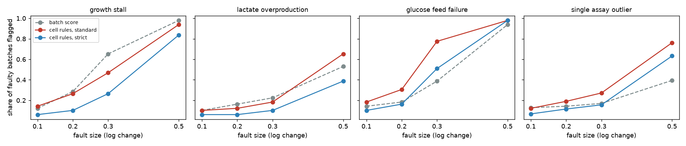

```{python}
#| label: setup
import json
from pathlib import Path

import matplotlib.pyplot as plt
import numpy as np
import pandas as pd
from IPython.display import Markdown

M = Path("metrics")
TARGETS = ["vcd", "tcd", "substrate", "byproduct"]
VAR = {"vcd": "VCD", "tcd": "TCD", "substrate": "Substrate", "byproduct": "Byproduct"}

FAMILY = {  # approach of each model in the pipeline
    "null_constant": "Baseline", "null_per_day": "Baseline",
    "xgb_raw": "Machine learning", "xgb_log_fold_change": "Machine learning",
    "null_xgb_ensemble": "Machine learning", "ml_sensors": "Machine learning",
    "mechanistic_lite": "Mechanistic",
    "hybrid_v3": "Hybrid", "hybrid_lite": "Hybrid", "hybrid_blend": "Hybrid",
    "hybrid_blend_ml": "Hybrid + ML",
}
DESC = {
    "null_constant": "Mean of each variable",
    "null_per_day": "Mean curve per culture day",
    "xgb_raw": "XGBoost on raw features",
    "xgb_log_fold_change": "XGBoost on log fold change vs. day 0",
    "null_xgb_ensemble": "Average of per-day mean and XGBoost",
    "ml_sensors": "Ridge + XGBoost with soft sensors",
    "mechanistic_lite": "Mass-balance ODE, no learned correction",
    "hybrid_v3": "Hybrid ODE (neural-net rates) + learned correction",
    "hybrid_lite": "Mechanistic ODE + learned correction",
    "hybrid_blend": "Average of hybrid_v3 and hybrid_lite",
    "hybrid_blend_ml": "Geometric average of hybrid_blend and ml_sensors",
}
# Reference palette (light), validated: categorical slots 1-3, neutral for baselines.
COLOR = {"Mechanistic": "#eb6834", "Machine learning": "#2a78d6", "Hybrid": "#1baf7a",
         "Hybrid + ML": "#0f7a54", "Baseline": "#9a9893"}
INK, INK_2, GRID = "#0b0b0b", "#52514e", "#e4e3df"
plt.rcParams.update({
    "font.size": 10, "axes.edgecolor": GRID, "axes.labelcolor": INK_2, "xtick.color": INK_2,
    "ytick.color": INK_2, "axes.spines.top": False, "axes.spines.right": False,
    "axes.grid": True, "grid.color": GRID, "grid.linewidth": 0.6, "figure.dpi": 130,
})


def load(name):
    p = M / name
    return json.loads(p.read_text()) if p.exists() else None


rows = []
for m in FAMILY:
    cv, ho, fp = load(f"cv_{m}.json"), load(f"{m}.json"), load(f"footprint_{m}.json")
    if cv is None:
        continue
    r = {"model": m, "family": FAMILY[m], "what": DESC[m]}
    r.update({f"cv_{k}": v for k, v in cv["cv_mape"].items()})
    r["holdout"] = ho["holdout_mape"]["score"] if ho else np.nan
    f = (fp or {}).get("footprint", {})
    r["model_mb"] = f.get("model_all_mb", np.nan)
    rows.append(r)
R = pd.DataFrame(rows).set_index("model")
v7 = load("hybrid_v7.json")
oa = load("option_a.json")  # the final model
anom = load("anomaly.json")


def md(df, index=True, floatfmt=".2f"):
    """A table that renders in both HTML and PDF (missing values as a dash)."""
    df = df.astype(object).where(df.notna(), None)
    if index:
        df = df.rename_axis("Name")
    return Markdown(df.to_markdown(index=index, floatfmt=floatfmt, missingval="–"))


def cv(m, k="score"):
    return f"{R.loc[m, f'cv_{k}']:.2f}"


def ho(m):
    return f"{R.loc[m, 'holdout']:.2f}"
```

> **Summary.** Neither a mechanistic model nor a machine-learning model alone predicts the
> cultures well. The mechanistic ODE gets the *shape* of a run right but misses batch-to-batch
> differences (CV MAPE `{python} cv("mechanistic_lite")`). Machine learning on its own captures
> those differences but has no notion of dynamics or mass balance (`{python} cv("ml_sensors")`).
> Using the ODE as the backbone and learning only its *errors* combines their strengths
> (`{python} cv("hybrid_lite")`, and down to `{python} cv("hybrid_blend_ml")` when the two
> families are averaged). The team's best stack, hybrid v7, scored
> `{python} f"{v7['leaderboard_mape']['score']:.3f}"` on the leaderboard. Its last
> improvements came from stacking more and more models, and that has real costs in
> footprint, reproducibility and scientific clarity, which we discuss openly in
> @sec-stacking. Our **final model, Option A**, keeps only what generalises, one
> sensor-assimilated mechanistic core with two learned corrections, and scored
> **`{python} f"{oa['leaderboard_mape']['score']:.2f}"`** (@sec-option-a).

# The problem

Each batch is one run of a fed-batch bioreactor: CHO cells grow on a substrate, produce a
metabolic byproduct (and later partly consume it), and some of them die. Four feeds are
dosed during the run, which raises the volume and dilutes every concentration. For each run
we must predict four quantities on each of 13 days:

* **VCD**, the viable cell density;
* **TCD**, the total cell density (living and dead);
* **substrate** concentration;
* **byproduct** concentration.

{width=75%}

**What is given.** 61 batches with 14 daily samples each. For 49 batches all measurements
are known. For the 12 test batches only the **day-0 measurements** are given, together with
the **complete feed schedule and volume log**. The task is therefore an *initial-value
problem with known inputs*: from the state at day 0 and the planned feeds, forecast the
whole run.

**How it is scored.** MAPE per variable, averaged over the four. MAPE weights small true
values heavily (early cell counts, low byproduct) and punishes over-prediction without
bound, so models are best fitted on a log or relative scale.

**One subtlety shapes everything that follows.** The feeding is *adaptive*: the main feed
(Feed B) tracks the most recent cell count (r = 0.87). Operators dose according to what
they measured. The feed log of a test batch therefore partly reveals how well it grew. A
data-driven model can exploit this (legitimately: the test feeds are given), but the link
runs "more cells → more feed", not the other way round, so it is not process insight.

# How we measured progress

All numbers in this report come from one reproducible pipeline (DVC), with every model
scored the same way:

| Batches | Role |
|---|---|
| 39 *dev* batches | 5-fold cross-validation (CV). All model choices are made here. |
| 10 *holdout* batches | One final check per model, never used to choose. |
| 12 *test* batches | Scored by the organisers (leaderboard). |

Folds split whole batches, never days of the same batch. A validation batch is predicted
exactly like a test batch: from its day-0 values and its feeds only. Anything learned from
data (including pooled statistics such as the average feed schedule) is learned inside the
training folds. Automated tests check that the holdout never influences fitting.

**Decision rule.** All models share the same 5 folds, so per-fold differences are far less
noisy than the scores themselves. A change was adopted only if it lowered the CV MAPE on
average **and** in at least 4 of the 5 folds. Rejected ideas are logged too
(`docs/experiments.md`).

# Baselines: how good is "the average run"?

```{python}
#| label: tbl-baselines
#| tbl-colwidths: [20,32,9,9,11,11,8]
#| tbl-cap: "Baselines (CV MAPE, %)."
cols = ["what", *[f"cv_{t}" for t in TARGETS], "cv_score"]
t = R.loc[["null_constant", "null_per_day"], cols].copy()
t.columns = ["Model", *[VAR[v] for v in TARGETS], "Mean"]
md(t)
```

A constant is useless (`{python} cv("null_constant")`), but the **mean curve per culture
day** is a strong baseline: `{python} cv("null_per_day")`. The runs follow a common recipe,
so most of the variance is the shared time course. Every model below has to beat about 10.6.

# The mechanistic approach

**Idea.** Write down the biology as ordinary differential equations: Monod-type growth on
the substrate, a death rate, substrate uptake, byproduct production and consumption, and the
dilution caused by each feed. Fit the kinetic parameters on the training batches, then
simulate each new batch forward from its day-0 state and its own feed schedule.

```{python}
#| label: tbl-mech
#| tbl-colwidths: [20,32,9,9,11,11,8]
#| tbl-cap: "Pure mechanistic model vs. the per-day mean (CV MAPE, %)."
t = R.loc[["null_per_day", "mechanistic_lite"], cols].copy()
t.columns = ["Model", *[VAR[v] for v in TARGETS], "Mean"]
md(t)
```

**Strengths.** The model is physically consistent by construction: concentrations stay
positive, feeds enter as mass inputs, dilution is exact, and VCD stays below TCD. Its
parameters mean something (a growth rate, a yield), and it can extrapolate to feeding
strategies that were never run, which no purely statistical model can claim.

**Weaknesses.** On its own it is **worse than the per-day mean**
(`{python} cv("mechanistic_lite")` vs. `{python} cv("null_per_day")`). A handful of shared
parameters cannot express how much batches differ from each other, the simplified metabolism
misses effects such as the byproduct switch, and errors compound over 13 days of simulation.
The figure shows the typical failure: the right shape, at the wrong level.



# The machine-learning approach

**Idea.** Treat each sample as a row of features (day, day-0 values, feeds so far, the feed
dosed right after the sample) and learn the targets directly, with gradient boosting and
ridge regression.

```{python}
#| label: tbl-ml
#| tbl-colwidths: [20,32,9,9,11,11,8]
#| tbl-cap: "The machine-learning ladder (CV MAPE, %)."
ml = ["xgb_raw", "xgb_log_fold_change", "null_xgb_ensemble", "ml_sensors"]
t = R.loc[ml, cols].copy()
t.columns = ["Model", *[VAR[v] for v in TARGETS], "Mean"]
md(t)
```

Plain XGBoost barely beats the per-day mean (`{python} cv("xgb_raw")`). Predicting the
change relative to day 0 on a log scale helps a little. The real step comes from **soft
sensors**: features computed from each batch's own logs that act as indirect
measurements. Two examples:

* **The unlogged volume.** The volume minus the logged feeds, with the sampling losses
  added back. What remains reflects base addition, and therefore how acidic the culture
  became (a proxy for byproduct).
* **The substrate bolus.** The size of the late substrate top-ups, set by a controller that
  reacts to the measured substrate. It brackets the substrate level on those days.

With them, ML alone reaches `{python} cv("ml_sensors")`.

**Strengths.** Flexible and fast (a fit takes about a second), and it reads batch-level
signals from the feed logs, including the operators' adaptive dosing.

**Weaknesses.** It knows nothing about dynamics or mass balance. With only 49 labelled
batches it cannot learn the physics, so it leans on correlations, some of them
reverse-causal (feeding follows growth). It cannot be trusted for a new feeding strategy,
and it is weakest exactly where the mechanism is strongest: **substrate**
(`{python} cv("ml_sensors", "substrate")` vs. `{python} cv("hybrid_lite", "substrate")` for
the hybrid below).

# The hybrid: the ODE as backbone, learning only its errors

**Idea.** Keep the mechanistic simulation as *stage 1*: it supplies a physically shaped
trajectory for every batch. A *stage 2* learns only the correction, the log-ratio between
the measurement and the stage-1 prediction, from the soft sensors and the batch's inputs.
Stage 2 blends two branches (a per-day ridge on the sensors and boosted trees) and, for
the cell counts, a nearest-neighbour "similar batches" member.

1. **Stage 1:** the mechanistic ODE simulates the run from the day-0 state and the feed and volume log.
2. **Soft sensors** are computed from the same logs.
3. **Stage 2** learns the correction, log(measured / simulated), from the sensors and the day-0 state.
4. **Forecast** = simulation × correction.

Stage 2 is trained on stage-1 predictions for batches stage 1 had *not* seen (inner folds).
The original team code skipped this, which made its CV slightly optimistic. Our version
fixes it and learns all pooled statistics inside `fit`.

```{python}
#| label: fig-complement
#| fig-cap: "Per-variable CV MAPE of the three approaches. The hybrid inherits the mechanism's strength on substrate and the data-driven model's flexibility on the cell counts; on byproduct the data-driven model is still best, which is why averaging the two families helps again."
show = ["mechanistic_lite", "ml_sensors", "hybrid_lite", "hybrid_blend_ml"]
labels = {"mechanistic_lite": "Mechanistic", "ml_sensors": "Machine learning",
          "hybrid_lite": "Hybrid", "hybrid_blend_ml": "Hybrid + ML average"}
fig, ax = plt.subplots(figsize=(7.2, 3.2))
y = np.arange(len(TARGETS))[::-1]
offs = np.linspace(0.27, -0.27, len(show))  # legend order, top to bottom
for o, m in zip(offs, show):
    vals = [R.loc[m, f"cv_{v}"] for v in TARGETS]
    c = COLOR[FAMILY[m]]
    ax.hlines(y + o, 0, vals, color=c, linewidth=2)
    ax.plot(vals, y + o, "o", color=c, markersize=6, label=labels[m],
            markeredgecolor="white", markeredgewidth=1.2)
ax.set_yticks(y, [VAR[v] for v in TARGETS])
ax.set_xlabel("CV MAPE (%)")
ax.set_xlim(0, None)
ax.grid(axis="y", visible=False)
ax.axvline(R.loc["null_per_day", "cv_score"], color=INK_2, linewidth=1, linestyle=":")
ax.text(R.loc["null_per_day", "cv_score"], y[0] + 0.48, " per-day mean (overall)",
        color=INK_2, fontsize=8, va="bottom")
ax.legend(frameon=False, ncol=4, loc="upper center", bbox_to_anchor=(0.5, -0.2), fontsize=8)
fig.tight_layout()
```

**Why the combination works.** The two families fail in different ways. The ODE's errors
are *systematic*: a whole batch running high or low, a byproduct switch at the wrong time.
These are smooth, low-dimensional, and learnable from a few batch-level signals. Learning
the correction is a much easier task than learning the whole trajectory. The data-driven
stage never has to discover that cells grow, that feeds dilute, or that substrate is
consumed: the ODE provides that for free. It only has to learn *how this batch differs*.
That is why it works with 49 batches.

```{python}
#| label: tbl-hybrid
#| tbl-colwidths: [19,27,8,8,11,11,8,8]
#| tbl-cap: "Hybrid models (CV and holdout MAPE, %)."
hy = ["hybrid_v3", "hybrid_lite", "hybrid_blend", "hybrid_blend_ml"]
t = R.loc[hy, ["what", *[f"cv_{x}" for x in TARGETS], "cv_score", "holdout"]].copy()
t.columns = ["Model", *[VAR[v] for v in TARGETS], "CV mean", "Holdout"]
md(t)
```

One finding surprised us. A crude stage 1 (`hybrid_lite`: a plain ODE without neural nets,
fitted in about a minute) is as good as an elaborate one (`hybrid_v3`: an ODE whose rates
are corrected by neural networks, about 15 minutes per fit on 16 cores). Once stage 2
corrects the errors, the details of stage 1 matter little. Its *shape* matters.



# Hybrid v7: the team's best stack

Tobias' hybrid v7 pushes the same idea further: four hybrids with different mechanistic
cores, blended per variable and per phase of the run.

1. A **sensor-assimilated Monod core**: 400 per-batch parameter draws, weighted by how well
   each matches the substrate interval implied by the bolus controller and the unlogged
   volume. The sensors enter *the ODE itself* rather than only its correction. This was the
   largest single gain of the whole project.
2. A functional-PCA trajectory model on the same kind of core.
3. Hybrid v3.
4. A **two-population core**: growing cells switch to a non-growing, byproduct-consuming
   state.

```{python}
#| label: tbl-v7
#| tbl-colwidths: [10,50,20,20]
#| tbl-cap: "Version history of the team's hybrid (Tobias' 7-fold CV over all 49 labelled batches; not comparable with our 5-fold CV)."
hist = pd.DataFrame(
    [["v3", "Hybrid ODE + soft sensors + learned correction", 7.674, None],
     ["v5", "Stack of hybrids on several cores", 7.366, 7.137],
     ["v6", "17-model stack, 10 more ideas", 7.244, None],
     ["v7", "4-model blend with sensor-assimilated cores", v7["cv7_mape"]["score"],
      v7["leaderboard_mape"]["score"]],
     ["Option A", "v7 cut to one core and two learned views (final)", oa["cv7_mape"]["score"],
      oa["leaderboard_mape"]["score"]]],
    columns=["Version", "What", "CV (7-fold)", "Leaderboard"])
md(hist, index=False, floatfmt=".3f")
```

```{python}
#| label: tbl-v7-weights
#| tbl-colwidths: [13,13,19,19,18,18]
#| tbl-cap: "Hybrid v7 blend weights per variable and phase of the run. Each variable relies on different cores, and the weights shift between the growth phase (days 1-6) and the late phase (days 7-13)."
w = pd.read_csv("hybrid_v7/blend_weights.csv", index_col=[0, 1])
w.columns = ["Assimilated Monod", "Trajectory (fPCA)", "Hybrid v3", "Two-population"]
w.index = w.index.set_levels([VAR.get(v, v) for v in w.index.levels[0]], level=0)
md(w.reset_index().rename(columns={'level_0': 'Variable', 'level_1': 'Days'}).round(2), index=False)
```

The weights tell the hybrid story in miniature. Substrate relies on the cores that know the
feeding controller. In the growth phase the cell counts and byproduct rely on hybrid v3.
Late in the run they shift to the two-population core, which models the transition the
other cores miss.

# Where the remaining error is

```{python}
#| label: fig-ladder
#| fig-cap: "CV MAPE of every model in the pipeline, coloured by approach (5 dev folds, 39 batches)."
order = R["cv_score"].drop("null_constant").sort_values(ascending=False)
fig, ax = plt.subplots(figsize=(7.2, 4.0))
ax.barh(range(len(order)), order.values, height=0.6,
        color=[COLOR[FAMILY[m]] for m in order.index])
ax.set_yticks(range(len(order)), order.index, fontsize=8.5)
for i, v in enumerate(order.values):
    ax.text(v + 0.1, i, f"{v:.2f}", va="center", fontsize=8, color=INK_2)
ax.set_xlabel("CV MAPE (%)")
ax.grid(axis="y", visible=False)
ax.set_xlim(0, order.max() * 1.12)
handles = [plt.Rectangle((0, 0), 1, 1, color=COLOR[f]) for f in COLOR]
ax.legend(handles, list(COLOR), frameon=False, fontsize=8, ncol=5, loc="upper center",
          bbox_to_anchor=(0.5, -0.16))
fig.tight_layout()
```

Most of the remaining error is a **per-batch offset**: a whole run is predicted, say, 9% too
low on every day. If each batch's offset were known, the CV MAPE of `hybrid_lite` would fall
from about 8.1 to **6.4**. The inputs barely predict these offsets (correlation 0.02 with
the feed-B dosing deviation, 0.13 with the day-0 values). Measurement noise puts a floor
near 6.2. In other words, the models are now limited by information that is not in the
inputs, not by their flexibility. More modelling capacity cannot recover it.

# The case against stacking more models {#sec-stacking}

The last improvements on the leaderboard came largely from **combining models**: averaging
hybrids, blending four cores with fitted weights, adding finishing models on top. It
worked: 7.137 → 6.752 on the leaderboard. But it is worth being honest about what this
practice costs.

**Footprint.** Every layer multiplies the cost of training and serving:

```{python}
#| label: tbl-footprint
#| tbl-colwidths: [20,50,15,15]
#| tbl-cap: "Size of the fitted models (all 49 batches). Fit times are not shown: the hybrids' stage-1 fits are cached, so the recorded times understate an uncached fit."
fp = R.loc[["ml_sensors", "mechanistic_lite", "hybrid_lite", "hybrid_v3", "hybrid_blend",
            "hybrid_blend_ml"], ["what", "model_mb", "cv_score"]].copy()
fp.columns = ["Model", "Model size (MB)", "CV MAPE"]
md(fp)
```

* An uncached `hybrid_v3` fit takes six stage-1 fits of about 15 minutes each on 16 cores
  (one on all training batches, five inner folds for the stacking). A blend fits all of its
  members.
* Hybrid v7 needs four mechanistic cores (one with 400 particles per batch), about 2,000
  lines of code in ten scripts, and a chain of cached intermediate files. Rerunning its
  pinned commit reproduces its CV exactly, but not the submitted file: most predictions
  agree within 0.2%, one differs by 20%, because an intermediate cache changed between
  submission and commit. The more layers, the more places for this to happen.
* For deployment on a controller or a soft-sensor device, a 2 MB ridge + boosting model and
  a 30 MB, multi-stage, multi-core blend are different engineering propositions.

**Diminishing and noisy returns.** Averaging `hybrid_v3` and `hybrid_lite` gained 0.05 CV
MAPE, because their predictions differ by only 1.4%. Averaging two near-copies adds little.
Averaging two genuinely different families (`hybrid_blend_ml`) gained more (0.16) but
improved only 3 of 5 folds, failing our own rule. Tobias' v6 stack of 17 models scored
*worse* than the 4-model v7. The leaderboard has only 12 batches. When two candidates differ
by 1-2% per prediction, a ±0.3 change in score is noise, and we saw both directions.

**It is unprincipled.** Each extra layer is chosen because it lowered a score, on the same
folds that report the score. Blend weights per variable and per phase, the choice among
candidate sets, the finishing steps: every choice spends a little of the validation set's
honesty. Tobias estimates about 0.03 MAPE of optimism from choosing among six 4-model sets
alone. More importantly, a stack does not explain anything. We cannot read a growth rate
or a yield from a geometric blend of four corrected simulators. Without the forecast
accuracy, the model gives no answer to *why* a batch behaves as it does, and that was half
of the challenge's brief.

**What we would keep.** The gains that came from **ideas** rather than **layers** are the
ones that generalise: soft sensors that turn the feed and volume logs into indirect
measurements, assimilating them *into* the ODE, and the hybrid structure itself. A
defensible final model is one mechanistic core with sensor assimilation plus a learned
correction. It is small enough to audit, fit and deploy, and within a few tenths of the
best stack. That is the model we adopted.

# Option A: the final model {#sec-option-a}

Option A is v7 cut down to that recipe. It keeps v7's **sensor-assimilated Monod core** and
puts two learned views on it: the hybrid v3 correction and the functional-PCA trajectory
model. Their predictions are blended geometrically, with weights per variable and per phase
fitted on out-of-fold predictions. The finishing steps are v7's: glucose goes to the most
likely point inside the interval implied by the bolus controller, and TCD ≥ VCD. Three of
v7's four cores and its TCD ratio model are gone.

```{python}
#| label: tbl-option-a
#| tbl-colwidths: [34,11,11,12,12,10,10]
#| tbl-cap: "Option A and hybrid v7 (MAPE, %). The 7-fold CV and the leaderboard are Tobias' protocol. The holdout row is Option A's out-of-fold prediction of our 10 holdout batches; it is not the same protocol as our holdout check (see text)."
rows_ = [
    ["Option A: 7-fold CV", *[oa["cv7_mape"][v] for v in TARGETS], oa["cv7_mape"]["score"]],
    ["Hybrid v7: 7-fold CV", *[v7["cv7_mape"][v] for v in TARGETS], v7["cv7_mape"]["score"]],
    ["Option A: leaderboard", *[oa["leaderboard_mape"][v] for v in TARGETS],
     oa["leaderboard_mape"]["score"]],
    ["Hybrid v7: leaderboard", *[v7["leaderboard_mape"][v] for v in TARGETS],
     v7["leaderboard_mape"]["score"]],
    ["Option A: our holdout (out-of-fold)", *[oa["holdout_mape_oof7"][v] for v in TARGETS],
     oa["holdout_mape_oof7"]["score"]],
]
md(pd.DataFrame(rows_, columns=["", *[VAR[v] for v in TARGETS], "Mean"]), index=False)
```

Option A is `{python} f"{oa['leaderboard_mape']['score'] - v7['leaderboard_mape']['score']:.2f}"`
worse than v7 on the leaderboard and
`{python} f"{oa['cv7_mape']['score'] - v7['cv7_mape']['score']:.2f}"` worse in CV, with one
core instead of four. Its code, ported to this repository, reproduces the submitted file exactly
(largest difference `{python} f"{oa['rerun_vs_submitted_pct']['max']:.0e}"`%), where v7's
rerun differs by up to 20%. It was chosen by the team for this simplicity, not by our
per-fold rule: it has no CV on our 5 dev folds.

```{python}
#| label: tbl-option-a-weights
#| tbl-colwidths: [20,20,30,30]
#| tbl-cap: "Option A blend weights per variable and phase of the run."
w = pd.read_csv("option_a/blend_weights.csv", index_col=[0, 1])
w.columns = ["Hybrid v3 correction", "Trajectory (fPCA)"]
w.index = w.index.set_levels([VAR.get(v, v) for v in w.index.levels[0]], level=0)
md(w.reset_index().rename(columns={'level_0': 'Variable', 'level_1': 'Days'}).round(2), index=False)
```

The hybrid v3 correction carries most of the weight. The trajectory model matters most for
substrate (half of the late phase) and for late byproduct. Option A has no model fitted on
our 39 dev batches, so it cannot be scored exactly like the models above. Its out-of-fold
predictions of our holdout batches come from models that never saw those batches, but were
fitted on about 42 of the 49 labelled batches, the other holdout batches included. They score
`{python} f"{oa['holdout_mape_oof7']['score']:.2f}"`, against
`{python} ho("hybrid_blend_ml")` for our best in-house model on its stricter protocol.



# Screening for abnormal batches

A forecast model also defines what *normal* looks like. Triantafyllia's anomaly analysis
(`notebooks/anomaly_v7.ipynb`) uses hybrid v7's out-of-fold residuals, log(measured /
predicted), of the 49 labelled batches as the normal behaviour, without any rejected batch or
label. Each batch is compared with the other 48. A **batch score** (robust z-values and a PCA
of the residual patterns) catches diffuse deviations, and **cell-level rules** catch one-day
spikes and deviations that persist for three days or more.

```{python}
#| label: tbl-anomaly
#| tbl-colwidths: [12,14,14,10,10,20,20]
#| tbl-cap: "Deviations flagged in the labelled batches at the standard level (z-values against the other 48 batches)."
dev = pd.read_csv("anomaly/cell_deviations.csv")
dev["variable"] = dev["variable"].map(VAR)
md(dev, index=False, floatfmt=".1f")
```

The batch score flags `{python} anom["batch_level"]["flagged"]` of 49 batches, the cell rules
`{python} anom["cell_level"]["flagged_standard"]` (strict level:
`{python} anom["cell_level"]["flagged_strict"]`). The two byproduct values on day 13 jump about
threefold within a day, which suggests a measurement or sampling problem rather than
metabolism. These are candidates for a process expert, not confirmed anomalies: the flagged
share matches the false-alarm rate the thresholds were set to.



No rejected batch exists, so detection was tested by injecting faults into normal batches.
Faults of about 65% are detected in
`{python} f"{min(anom['detection_size_0.5'].values()):.0%}"`-`{python} f"{max(anom['detection_size_0.5'].values()):.0%}"`
of cases on average over the four fault types, depending on the detector, while faults of
10-20% are detected at about the false-alarm rate
(`{python} f"{anom['false_alarm_rate']['batch score']:.0%}"` for the batch score,
`{python} f"{anom['false_alarm_rate']['cell rules, strict']:.0%}"` for the strict rules), so
they cannot be told apart from normal variation. The detector is a screening tool: useful
when bad batches are not extremely rare, and it cannot replace review. The 12 test batches
can only be checked on their inputs. The PCA check flags
`{python} " and ".join(anom["test_inputs"]["flagged"])`. Both have a day-0 value outside the
range of the labelled batches.



# Reproducibility

* **One pipeline.** `dvc repro` rebuilds every number and figure in this report from the raw
  data, the frozen split, the code and `params.yaml`. DVC reruns only what changed.
* **Versioned models.** Model versions are git tags in a registry (GTO), not "_v2" file
  names. Each tag points at the commit whose code, parameters and lock file produced it.
  Option A, the final model, is registered in stage `prod`; its code is ported unchanged
  from its branch. Hybrid v7 runs from a pinned commit of its own branch.
* **Logged decisions.** Every experiment, including the rejected ones, is recorded with its
  per-fold result in `docs/experiments.md`.
* **No data in git.** Only hashes of the challenge data, and no file in `reports/` contains
  measured values.

# Limitations and next steps

* Our CV (5 folds, 39 batches) and Tobias' (7 folds, 49 batches) are different protocols.
  Option A and hybrid v7 are compared with our models on the leaderboard, and Option A also
  through its out-of-fold predictions of our holdout batches, which are not quite our holdout
  protocol.
* The anomaly screen uses v7's residuals. Rebuilding it on Option A's would match the final
  model; we kept the analysis as it was done.
* Data-driven parts exploit the adaptive feeding, which helps the forecast but would break
  under a new feeding strategy. A deployment for process design should restrict stage 2 to
  causal inputs, or at least test it on feeding schedules outside the historical range.
* Next steps, in order of expected value: a single sensor-assimilated core with a learned
  correction as the reference model; interpretable reporting of the fitted kinetic
  parameters per batch; and asking for online sensor data (pH, dissolved oxygen, base
  addition), which would attack the per-batch offsets directly.
